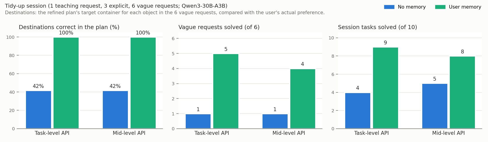

# Midterm Results: What Each Memory Contributes

Our online robot-programming agent has two persistent memories. We evaluate each on the kind of task it is meant for.

- **User memory** (long-term preferences and standing requests, stored with the user's own words as evidence) helps the agent plan **long-horizon, multi-object tidy-up sessions** under vague requests. On the same task sequence, it raises the share of correct destinations in the plan from 42% to 100%. Session success rises from 4/10 to 9/10 with the task-level API, and from 5/10 to 8/10 with the mid-level API.
- **Skill memory** (executable skills extracted from verified executions, with applicability checks and execution history) helps on a **harder manipulation** that is easy to get wrong when the code is written from scratch: aligning a pen with a narrow case. Over three layout sets it raises success from 2.7/10 to 7.3/10, with 63% fewer failed executions and 47% fewer LLM calls.
- Whether combining the two solves tasks that are **both** long-horizon and manipulation-heavy is left for the second half of the project (Section 4).

**Common setup.**

- **Simulation.** Robosuite/MuJoCo tabletop with a Franka Panda.
- **Perception.** Top-down RGB-D only (colour segmentation plus depth) plus proprioception. Simulator ground truth (GT) is used only for offline scoring.
- **Model.** One open-weight model, Qwen3-30B-A3B-Instruct-2507 served with vLLM, plays every role: request refiner, planner, coder and reflection.
- **Retries.** Each subgoal gets up to 3 attempts, each followed by a camera check and measured diagnostic facts.

## 1. User memory: long-horizon tidy-up under vague requests

**Session.** A simulated user first states a preference once: *"From now on, please always put my toy blocks in the purple toy box, my mugs on the cyan tray and my books on the orange tray. Tidy the desk that way now."* The session then has:

- 3 explicit single-object requests;
- 6 vague requests on new layouts, such as *"Tidy up my desk, please."* or *"Put my things where they belong."*

Seven of the 10 tasks involve two or three objects; some require clearing an occupied container first.

**How user memory works.**

1. A message is converted into rules only when the user's words support them. The object word must be followed by the colour of that container, and the message must contain lasting wording such as "always" or "from now on".
2. Later, the request refiner turns a vague request into explicit goals. Each goal is labelled with its source: the instruction, user memory, or an explicit assumption.
3. Goals that cite a source that does not support them are dropped.

| Metric (10-task session) | API level | No memory | Skill memory | **User memory** | User + skill |
|---|---|---|---|---|---|
| Tasks solved (GT) | task | 4 | 5 | **9** | 9 |
| | mid | 5 | 5 | **8** | 8 |
| Vague requests solved (of 6) | task | 1 | 1 | **5** | 5 |
| | mid | 1 | 2 | **4** | 4 |
| Destinations in the plan correct (vague requests) | both levels | 5/12 (42%) | 5/12 | **12/12 (100%)** | 12/12 |
| Multi-object tasks solved (of 7) | task | 1 | 2 | **6** | 6 |
| | mid | 2 | 3 | **5** | 5 |

**Findings.**

- Without user memory, every destination in the vague requests is an *assumption*, and 7 of 12 are wrong. Examples:
  - mugs and books swapped (`tidy_1001`);
  - a block sent to the cyan tray, with the mug left out (`tidy_1005`).
- With user memory, all 13 destinations cite *user_memory*, and all 12 that are scored against the user's preference are correct.
- The gain holds with both robot APIs, and skill memory alone does not provide it (5/10).
- With user memory the remaining failures are execution failures, not planning ones; the plans were correct.
  - `tidy_1003` failed at both API levels: a book has to be taken out of the walled toy box.
  - `tidy_1001` failed at the mid level because of code errors in the generated programs.

## 2. Skill memory: an alignment-critical manipulation

**Task.** Put a pen (14 × 1.2 × 1.2 cm) into a narrow pen case (15.5 × 4.5 cm inside, 1.5 cm walls).

- Both the pen and the case have random orientations.
- The pen fits only within about 13° of the case axis.
- The pen is grasped across its width, so its long axis is 90° from the finger direction. The program must turn it relative to the gripper; passing the case direction as the gripper yaw leaves it crosswise.
- **Scripted check (no LLM).** Turning succeeds 4/4; not turning fails 0/4.

**API.** The agent uses the mid-level API: grasp candidates, `grasp`, `free_spots`, `carry_to`, `rotate_by`, `lower_until_contact`, `open_gripper`, `check`.

**How skill memory works.**

1. After a camera-verified success, the program is rewritten as a parameterized skill and validated on two unseen layouts.
2. It is stored with its applicability conditions and history.
3. For a new subgoal, a three-level applicability check decides:
   - *applicable*: run the skill as is, with no new code;
   - *uncertain*: show its code to the coder to adapt.

**Design.**

- Three layout sets (A, B, C).
- Every run has the same sequence: one task in which the user explains the alignment once, followed by 10 pen tasks with the plain instruction *"Put the ⟨colour⟩ pen in the green pen case."*
- 14 runs in total, 140 scored pen tasks.

| Metric (10 pen tasks per run) | No memory (n=3) | **Skill memory (n=3)** |
|---|---|---|
| Tasks solved | 2.7 ± 0.6 (A/B/C: 2, 3, 3) | **7.3 ± 2.5 (7, 10, 5)** |
| Solved at the first attempt | 2.3 | **7.0** |
| Failed executions | 22.7 | **8.3** |
| LLM calls | 90.7 | **47.7** |
| Generated tokens | 9,964 | **7,371** |
| Success after the run's first success | 6/28 (21%) | **20/28 (71%)** |

| Skill memory, pooled over runs | |
|---|---|
| Skills validated on unseen layouts | 6/6 |
| Direct reuse succeeded (skill judged *applicable*) | 14/16 |
| Skill code adapted when judged *uncertain*; succeeded at the first attempt | 6/12 |
| Applicability verdict matched the outcome | 15/18 |

**Findings.**

- Skill memory beats no memory on every layout set.
- Its mechanism is visible in the runs: once one attempt succeeds, the program becomes a validated skill, and later tasks reuse it directly (14/16 successful), without writing or debugging new code.
- Without it, the model keeps making the same orientation mistake. The success rate on the tasks after a run's first success is 71% with skill memory versus 21% without.

## 3. Videos

Side-by-side comparisons on the same task: no memory on the left, memory on the right.

- `results/demo/user_memory_pairs.mp4`: vague requests `tidy_1005` (mid-level API) and `tidy_1001` (task-level API). Each panel shows the planned destinations and their source (assumption vs user memory).
- `results/demo/skill_memory_pairs.mp4`: pen tasks `pen_2001`, `pen_3004`, `pen_4003`, one per layout set. Without memory the pen ends crosswise after 3 failed attempts; with skill memory a learned skill places it in one attempt.
- `results/demo/mid_level_with_code.mp4`: a narrated session replay with the executing code shown beside the robot.

## 4. Next step: combining the two memories

The two experiments isolate each memory on the task it targets. We also ran both memories together on the pen task (the "User + skill" bars above). The combination was not better than skill memory alone:

- set A: 7, 7 vs 7;
- set B: 10 vs 10;
- set C: 0 vs 5.

On set C the first task never succeeded, so no skill was learned. The stored failure lessons, which blamed the grasp, then misled later attempts.

Combining the memories on tasks that are *both* long-horizon and manipulation-heavy is the main question for the second half of the project. Two open problems come first:

- verifying failure lessons before they are reused;
- securing an early verified success so that skill memory has something to reuse.

## 5. Limitations

- Each condition was run once on the session, and three times (three layout sets) on the pen task. Differences of one or two tasks are within run-to-run variation.
- There is one simulated user and a small object set (blocks, mugs, notebooks, pens).
- Perception is colour-based segmentation.
- The pen experiment uses the mid-level API after several harness fixes (all recorded in the git history). The session experiment's mid-level results were obtained before those fixes.

## 6. Reproducibility

- **Code.** `skill_memory_agent`; API levels are selected with `SMA_API_LEVEL=task|mid`. Jobs ran on NUS Hopper (PBS, 1 GPU each).
- **Session results.**
  - `results/final_20261017T084229Z` (task-level, job 672093);
  - `results/mid30b_20261017T110309Z` (mid-level, jobs 672359 and 672468).
- **Pen results.** `results/main_experiment/runs.json` lists every run; `REPLICATION.md` has the per-run table; `REPORT.md` has the full pen-task analysis.
- **Per task.** `episode.json` holds programs, call traces, the refined task specification with goal sources, diagnoses and lessons; `video.mp4` is the recording.
