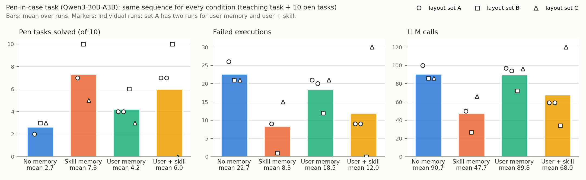

# Main Experiment: User Memory and Skill Memory on an Alignment-Critical Placement Task

## 1. Question

Our agent keeps two persistent memories:

- **User memory** stores what a user has asked for, such as preferences and standing requests, each with verbatim evidence.
- **Skill memory** stores executable skills extracted from verified executions, with applicability conditions and execution history, plus verified failure lessons.

The main experiment asks how each memory, and their combination, affects success and cost on a task where a correct program is hard to write from scratch but easy to reuse once found.

## 2. Task

The task is to put a pen into a narrow pen case. The scene is a Robosuite/MuJoCo tabletop with a Franka Panda.

- **Objects.** The pen measures 14 × 1.2 × 1.2 cm. The case is 15.5 × 4.5 cm inside, has 1.5 cm walls and a random yaw. The pen also starts at a random yaw.
- **Why it is hard.** The pen fits only if its long axis is within about 13° of the case axis; otherwise it lands across the walls. The pen is grasped across its short side, so its long axis is 90° from the finger direction. A correct program must therefore turn the held pen relative to the gripper. Writing `carry_to(..., yaw=<case axis>)` is the natural mistake, and it leaves the pen crosswise.
- **Perception.** The agent sees only a top-down RGB-D camera (colour segmentation plus depth), proprioception, and the results of its own calls. Simulator ground truth (GT) is used only for offline scoring.
- **API.** The agent writes Python against a mid-level, object-centric API:
  - `grasp_candidates`, `grasp`, `free_spots`, `carry_to`, `rotate_by`, `lower_until_contact`, `open_gripper`, `retreat`, `check`.
  - The system does perception, grasp proposal and motion execution. The model chooses the grasp, the placement pose and orientation, the order of actions, and how to recover.
- **Scripted check (no LLM).** On 4 layouts, turning the pen to the case axis succeeds 4/4, and placing it without turning fails 0/4.
- **Model.** Qwen3-30B-A3B-Instruct-2507 (open weights, vLLM, temperature 0.2) plays every role. Each subgoal gets up to 3 attempts. Every attempt is followed by a camera check, measured diagnostic facts and a one-sentence reflection.

## 3. Design

- **Same sequence for every condition.** Each run is one *teaching task* followed by 10 pen tasks with the plain instruction *"Put the ⟨colour⟩ pen in the green pen case."*
- **The teaching task.** In it the user says once: *"From now on, whenever you put a pen in my pen case, turn the pen so that it lines up with the long side of the case before you lower it. Please put the ⟨colour⟩ pen in the green pen case now."*
  - Every condition sees this instruction in that task.
  - Only user memory carries it to later tasks, as a stored long-term handling request with a verbatim quote.
  - Skill memory can only learn from a verified success, in any task.
- **Conditions.**
  - none;
  - skill (skill memory);
  - user (user memory);
  - both.
- **Layout sets.** A (`pen_2000`–`2009`), B (`pen_3000`–`3009`) and C (`pen_4000`–`4009`), each with its own teaching layout. On set A, user and both were each run twice.
- **Total.** 14 runs; 140 scored pen tasks. Teaching tasks are not scored.

## 4. Results

Means over runs (± sd, min–max); 10 pen tasks per run.

| Metric | No memory (n=3) | Skill memory (n=3) | User memory (n=4) | User + skill (n=4) |
|---|---|---|---|---|
| Tasks solved | 2.7 ± 0.6 (2–3) | **7.3 ± 2.5 (5–10)** | 4.2 ± 1.3 (3–6) | 6.0 ± 4.2 (0–10) |
| Solved at first attempt | 2.3 | **7.0** | 3.2 | 6.0 |
| Failed executions | 22.7 | **8.3** | 18.5 | 12.0 |
| Execution attempts | 25.3 | **15.7** | 22.8 | 18.0 |
| LLM calls | 90.7 | **47.7** | 89.8 | 68.0 |
| Generated tokens | 9,964 | **7,371** | 10,754 | 8,924 |

Per layout set (tasks solved; set A user and both have two runs each):

| Set | No memory | Skill memory | User memory | User + skill |
|---|---|---|---|---|
| A | 2 | 7 | 4, 4 | 7, 7 |
| B | 3 | 10 | 6 | 10 |
| C | 3 | 5 | 3 | 0 |

### Skill transfer and applicability, pooled over runs

| | Skill memory | User + skill |
|---|---|---|
| Skills validated on unseen layouts | 6/6 | 6/6 |
| Direct reuse (skill judged *applicable*) succeeded | 14/16 | 14/16 |
| Skill judged *uncertain*; its code adapted by the coder; first attempt succeeded | 6/12 | 10/14 |
| Applicability verdict matched the outcome | 15/18 | 14/16 |
| Success rate on the tasks after the run's first success | 20/28 (71%) | 24/30 (80%) |

For comparison, the success rate after the first success was 6/28 (21%) with no memory and 16/37 (43%) with user memory only.

**Cost.** Wall time is not comparable across conditions, because runs landed on cluster nodes of very different speeds. Attempts and LLM calls are the cost measures.

## 5. Findings

1. **Skill memory gives the largest and most consistent gain.**
   - It beats no memory on every layout set (7 vs 2, 10 vs 3, 5 vs 3): +4.7 tasks on average, with 63% fewer failed executions and 47% fewer LLM calls.
   - The mechanism: one verified success becomes a validated skill (6/6 validations) that later tasks run directly (14/16 succeeded) or adapt. After its first success, a run with skill memory solved 71–80% of the remaining tasks, against 21% without memory.
2. **User memory gives a smaller, inconsistent gain on this task.**
   - Carrying the user's handling request forward raised success on sets A and B (4 vs 2, 6 vs 3) but not on C (3 vs 3).
   - Knowing that the pen must be aligned does not reliably produce code that aligns it.
   - User memory's main contribution in our system is deciding *what* to do under vague instructions, shown in our tidy-up session: 4/10 → 9/10 task success with the task-level API, and 5/10 → 8/10 with the mid-level API. It is not the *how* of this manipulation.
3. **The combination is not superadditive.**
   - User + skill matched skill memory on sets A and B, and collapsed on set C (0/10).
   - On C, the teaching task failed in all three attempts, so no skill existed. The only stored experience was the model's own failure lessons, which blamed the grasp ("grasp along the long axis", "pick another height"). Later programs followed them and failed to pick up the pen.
   - The same layouts gave 5/10 with skill memory alone, whose teaching task happened to succeed at the first attempt.
4. **The deciding event is the first verified success.** All runs with skill memory that reached an early success went on to reuse it. The one run that never succeeded did worse than no memory. Failure lessons without a verified success can be harmful, even with our verification that flags lessons followed by two further failures.

## 6. Pilot run and why it was revised

Our first, single-run comparison reported:

- no memory 0/10;
- skill memory 2/10 and 0/10;
- user memory 4/10;
- user + skill 7/10.

That looked like a superadditive effect. In that pilot, however, no memory and skill memory ran without the teaching task, so they never saw the alignment instruction even once.

With the teaching task given to every condition (Section 3), skill memory alone reached 7/10 on the same layouts (set A), equal to user + skill. The pilot's apparent synergy came from that difference in sequences, not from user memory.

## 7. Limitations

- **Sample size.** Three layout sets and 14 runs, with one run per condition and set (two for user and user + skill on A). The spread is large (user + skill: 0–10). Repeated runs on the same layouts agreed closely for user memory and user + skill (4 and 4; 7 and 7). The two pilot runs of skill memory differed (2 vs 0), so sampling still matters when everything hinges on one early success. Most of the variance comes from layouts and from whether that first success happens.
- **Scope.** Single task family, single simulated user, colour-based perception, one 30B open-weight model.
- **Known weaknesses.**
  - Skill extraction does not reject hard-coded scene angles (seen once in the pilot).
  - The reach-based physical check is conservative (many *uncertain* verdicts).
  - Failure lessons can mislead when no success exists.
- **Harness changes before these runs.** All are in the git history:
  - parking no longer turns a held object;
  - motions wait for the wrist yaw to settle;
  - the API documentation states that `carry_to`'s yaw is the finger direction;
  - the sandbox allows `next`.

  All replication runs use the same code (`468e8d2`, which differs from `60f5dab` only by layout-set suite names).

## 8. Reproducibility

- **Runs.** Listed in `runs.json`, with per-run metrics in `REPLICATION.md`.
  - Set A: `penteach30b_{user,both}_20261017T162704Z` and `penrep_A*_20261017T172651Z`.
  - Sets B and C: `penrep_{B,C}_*_20261017T172651Z`.
  - Pilot: `pen30b_20261017T152702Z`, `pen30b_skill_20261017T155808Z`.
- **Hopper PBS jobs.** 672844–672845 and 672916–672927.
- **Per task.** Each task directory holds `episode.json` (programs, call traces, diagnoses, lessons) and `video.mp4`.
- **Memory files.** `memory.json` (skills, lessons) and `user_memory.json` (rules, handling requests).
- **Aggregation.** `python scripts/aggregate_pen_memory.py results results/main_experiment/runs.json results/main_experiment/REPLICATION.md`.
