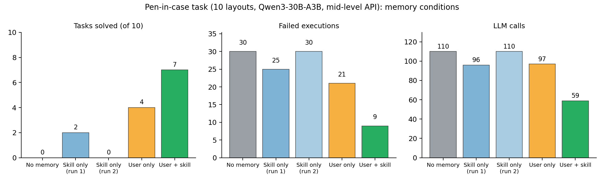

# Main Experiment: User Memory and Skill Memory on an Alignment-Critical Placement Task

## 1. Question

Our agent keeps two persistent memories:

- **User memory** stores what a user has asked for over time, such as preferences and standing requests, each with verbatim evidence.
- **Skill memory** stores executable skills extracted from verified executions, together with applicability conditions and execution history.

The main experiment asks whether each memory helps on its own, and whether the two are complementary. The setting is a task where a correct program is hard to write from scratch but easy to reuse once found.

## 2. Task

The task is to put a pen into a narrow pen case. The scene is a Robosuite/MuJoCo tabletop with a Franka Panda.

- **Objects.** The pen measures 14 × 1.2 × 1.2 cm. The case is 15.5 × 4.5 cm inside, has 1.5 cm walls and a random yaw. The pen also starts at a random yaw.
- **Why it is hard.** The pen fits only if its long axis is within about 13° of the case's long axis; otherwise it lands across the walls. The pen must be grasped across its short side, so its long axis is 90° away from the finger direction. A correct program therefore has to turn the held pen relative to the gripper. Writing `carry_to(..., yaw=<case axis>)` is the natural mistake, and it leaves the pen crosswise.
- **Perception.** The agent sees only a top-down RGB-D camera (colour segmentation plus depth), proprioception, and the results of its own calls. Simulator ground truth (GT) is used only for offline scoring and is never shown to the model.
- **API.** The agent writes Python against a mid-level, object-centric API:
  - `grasp_candidates`, `grasp`, `free_spots`, `carry_to`, `rotate_by`, `lower_until_contact`, `open_gripper`, `retreat`, `check`.
  - The system performs perception, grasp proposal and motion execution. The model chooses the grasp, the placement pose and orientation, the order of actions, and how to recover.
- **Scripted sanity check (no LLM).** On 4 layouts, turning the pen to the case axis succeeds 4/4, and placing it without turning fails 0/4. The primitives can solve the task, and alignment is the deciding step.
- **Model.** Qwen3-30B-A3B-Instruct-2507 (open weights, served with vLLM) plays every role: refiner, planner, coder and reflection. Each subgoal gets up to 3 attempts. Every attempt is followed by a camera check, measured diagnostic facts and a one-sentence reflection.

## 3. Conditions

All conditions use the same 10 pen layouts (`pen_2000`–`pen_2009`), each with the plain instruction *"Put the ⟨colour⟩ pen in the green pen case."*

| Condition | User memory | Skill memory | Sequence |
|---|---|---|---|
| No memory | – | – | 10 pen tasks |
| Skill only | – | ✓ | 10 pen tasks (run twice) |
| User only | ✓ | – | 1 teaching task + 10 pen tasks |
| User + skill | ✓ | ✓ | 1 teaching task + 10 pen tasks |

In the teaching task the user says once: *"From now on, whenever you put a pen in my pen case, turn the pen so that it lines up with the long side of the case before you lower it. Please put the blue pen in the green pen case now."*

- **User memory** accepts this as a long-term handling request for pens, because the quote is verbatim and the message contains lasting wording. Later tasks pass the request to the code agent verbatim.
- **Skill memory** extracts a parameterized skill from a camera-verified success. It validates the skill on two new layouts and stores it with its conditions and history. For a new subgoal it runs a three-level applicability check (goal, state, physical):
  - *applicable*: the stored skill is executed directly, with no new code;
  - *uncertain*: the skill's code is shown to the coder to adapt.

  Skill memory also keeps failure lessons, which are flagged as not helpful after two later failed attempts.

## 4. Results

All numbers below cover the same 10 pen tasks; the teaching task is excluded.

| Metric (10 pen tasks) | No memory | Skill only (run 1 / run 2) | User only | **User + skill** |
|---|---|---|---|---|
| Task success (GT) | 0/10 | 2/10 / 0/10 | 4/10 | **7/10** |
| Solved at the first attempt | 0 | 1 / 0 | 2 | **7** |
| Execution attempts | 30 | 27 / 30 | 25 | **16** |
| Failed executions | 30 | 25 / 30 | 21 | **9** |
| Skill executed directly (succeeded) | – | 2 (1) / 0 | – | 5 (4) |
| LLM calls | 110 | 96 / 110 | 97 | **59** |
| Generated tokens | 11,697 | 12,753 / 13,042 | 12,328 | **7,153** |

Additional results for the proposal's metrics:

- **Skill transfer to new scenes.** In *user + skill*, the skill extracted from the teaching task passed validation on 2/2 unseen layouts. It was then executed directly 5 times and succeeded 4 times. Five more times its code was adapted by the coder, and 3 of those succeeded at the first attempt. In *skill only, run 1*, the first success came only at the 7th task (`pen_2006`); its skill validated 2/2 and succeeded on direct reuse in `pen_2007`.
- **Applicability-check accuracy.** Over executed skill calls, the verdict matched the outcome 4/5 times (*user + skill*) and 1/2 times (*skill only, run 1*). The one wrong *applicable* verdict in each run came from a failed grasp during reuse, and from a scene-specific angle hard-coded in the skill.
- **Task completion time.** Wall time is not comparable across conditions, because jobs ran on different cluster nodes (seconds per task ranged from 12 to 205 for similar work). We therefore report attempts and LLM calls as the cost measures.

## 5. Findings

1. **Each memory helps on its own, on a different part of the problem.**
   - *User memory supplies the "what": the requirement to align the pen.* Without it the model rarely succeeded: 2 of 30 pen tasks across the three runs without user memory. Its typical program passed the case direction as the gripper yaw. With the stored request, the model started calling `rotate_by(case axis − pen axis)`, and success rose from 0/10 to 4/10.
   - *Skill memory supplies the "how" once it has been found.* A verified success becomes an executable skill that later tasks run directly or adapt.
2. **Together they are more than additive.** User memory alone gives 4/10. Skill memory alone gives 2/10 and 0/10, because it can only store a success the agent has already achieved, and alone the agent rarely achieves one. Together they give 7/10, with all 7 solved at the first attempt, and 57% fewer failed executions and 39% fewer LLM calls than user memory alone.
   - The mechanism: user memory makes the first success happen early (the teaching task succeeded at its second attempt); skill memory then turns that one success into a validated, reusable program.
3. **Skills help even when not judged directly applicable.** In *user + skill*, the reach-based physical check marked the skill *uncertain* in 5 tasks. Showing its code to the coder for adaptation still solved 3 of them at the first attempt.
4. **Failure lessons need verification.** Without a correct example, the model's own reflections mostly blamed the grasp, for example "grasp along the pen's long axis", which is infeasible for an 8 cm gripper. They did not identify the missing rotation. Unverified lessons propagated into later tasks; our verification marks lessons that preceded two further failures as not helpful. Correct lessons, however, only appeared once a success existed.

## 6. Limitations

- **Single runs.** Each condition was run once, and skill only twice; *skill only* is highly variable (2/10 versus 0/10). The two user-memory conditions include one extra teaching episode, which also gives skill memory an earlier chance to learn.
- **Remaining failures in user + skill.**
  - Twice the skill was judged *uncertain* and the newly written code was misaligned by 24°–32°.
  - Once a direct reuse did not pick the pen up.
- **Known extraction weakness.** One extracted skill (*skill only, run 1*) hard-coded a scene-specific yaw. The extraction check currently rejects hard-coded coordinates but not hard-coded angles.
- **Experimental setup.**
  - Perception is colour-based segmentation, not SAM-family segmentation.
  - There is a single simulated user and a single object family.
  - The model is a 30B open-weight model; larger models were out of scope.
- **Harness fixes made before the reported runs.** All are in the git history:
  - parking the arm no longer turns a held object;
  - motions wait for the wrist yaw to settle;
  - the API documentation states explicitly that `carry_to`'s yaw is the finger direction;
  - the sandbox allows the builtin `next`.

  All reported conditions use the same final code (`60f5dab`).

## 7. Reproducibility

- **Hopper PBS jobs (1 GPU each).**
  - `672709`: no memory, skill only run 2 (interactive queue)
  - `672803`: skill only run 1 (small queue)
  - `672844`: user only (small queue)
  - `672845`: user + skill (small queue)
- **Code.** `skill_memory_agent` at `60f5dab` (mid-level API, `SMA_API_LEVEL=mid`).
- **Results.** Under `results/`:
  - `pen30b_20261017T152702Z/{none,skill}`
  - `pen30b_skill_20261017T155808Z/skill`
  - `penteach30b_user_20261017T162704Z/user`
  - `penteach30b_both_20261017T162704Z/both`

  Each task directory holds `episode.json` (programs, call traces, diagnoses, lessons) and `video.mp4`. Memory files are `memory.json` (skills, lessons) and `user_memory.json` (rules, handling requests).
- **Example videos.**
  - `penteach30b_both_.../both/pen_2001/video.mp4`: direct skill reuse, solved in one attempt.
  - `penteach30b_user_.../user/pen_2002/video.mp4`: the user's request leads to `rotate_by` alignment.
  - `pen30b_skill_.../skill/pen_2006/video.mp4`: failure, then repair, then skill extraction.
  - `pen30b_20261017T152702Z/none/pen_2000/video.mp4`: the typical crosswise failure.
